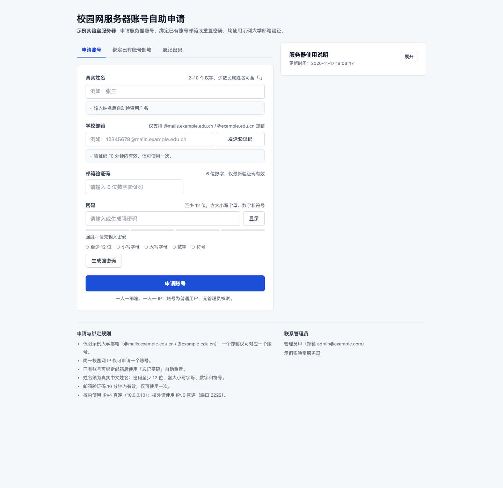
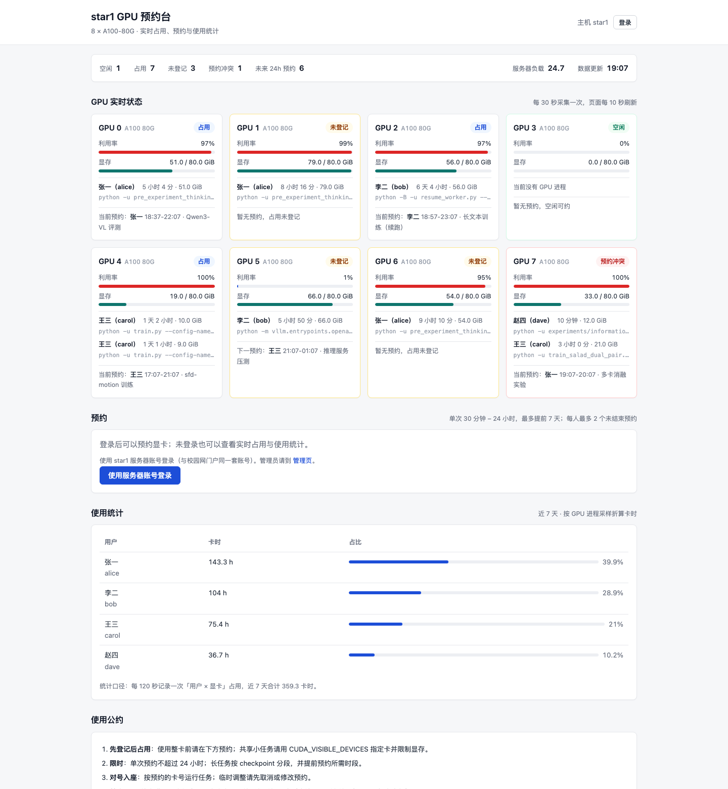
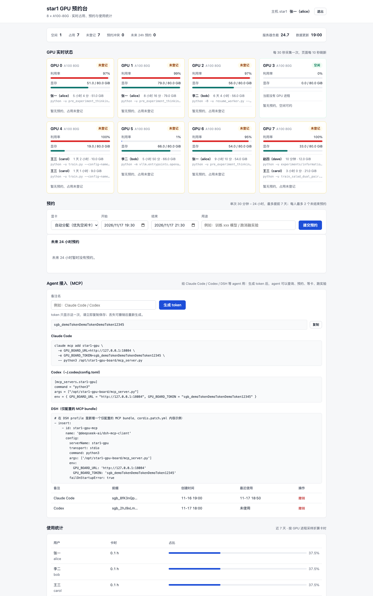

# star1-lab-management

实验室共享服务器（star1）的**服务器管理系统**，包含两个可独立部署、又相互复用的子系统：

| 子系统 | 作用 | 端口（示例） |
|---|---|---|
| [`campus-signup/`](campus-signup/) | 校园网账号自助开户门户：学校邮箱验证码注册 Linux 账号、绑定已有账号邮箱、忘记密码；`/admin` 管理全部用户（重置密码 / 锁定 / 绑定邮箱）；root provisioner 负责 `useradd` / `chpasswd` / 密码校验 | HTTPS 8444 |
| [`gpu-board/`](gpu-board/) | GPU 预约与看板：8×A100 实时占用（谁在用、跑多久、在跑什么）、按卡/时段预约、卡时统计；内置 **MCP 接口**，Claude Code / Codex / DSH 等 agent 可以自己查卡、预约、等卡、在预约卡上跑实验 | HTTPS 8083 |

GPU 看板**复用**账号门户的整套账号与运维体系：同一套 Linux 账号、同一个 root provisioner（校验密码/列用户）、同一个管理员 token、同一张 TLS 证书、同一套浅色极简视觉。门户负责“谁能用服务器”，看板负责“GPU 怎么分”。

## 截图

**账号自助开户门户（campus-signup）**



**GPU 实时看板（gpu-board）**



**Agent 接入（MCP）：生成 token 后直接给出 Claude Code / Codex / DSH 配置**



## 架构

```text
                     ┌─────────────────────────────────────┐
  浏览器 ───────────▶│ campus-signup web  :8444 (signupapp)│
                     │ 注册 / 绑定邮箱 / 忘记密码 / admin  │
                     └───────────────┬─────────────────────┘
                                     │ Unix socket（SO_PEERCRED 仅允许 signupapp）
                     ┌───────────────▼─────────────────────┐
                     │ campus-signup-provisioner   (root)  │
                     │ useradd / chpasswd / verify_password│
                     └───────────────┬─────────────────────┘
                                     │ /home/<user>、/etc/shadow
                     ┌───────────────▼─────────────────────┐
  浏览器 ───────────▶│ star1-gpu-board web  :8083(signupapp)│
                     │ 实时看板 / 预约 / 卡时 / 管理员页   │
  agent ──stdio MCP─▶│ mcp_server.py（stdio）              │
                     │ 只读 nvidia-smi；写自己的 SQLite    │
                     └─────────────────────────────────────┘
```

- 两个服务都用 **systemd** 管理，都运行在专用 `signupapp` 账号下；GPU 看板有 `MemoryMax=128M`、`CPUQuota=50%`、`Nice=19` 等资源上限，不影响服务器上的其他 CPU/内存任务。
- 所有密码只在内存中传给本机 provisioner 校验，**不落库、不写日志**；GPU 看板的 agent token 可随时撤销、只代表本人。

## 部署顺序

环境要求：Ubuntu 24.04（或同类发行版）、Python 3.12、systemd、GPU 服务器；门户只依赖 Python 标准库 + 仓库内自带的 `pypinyin`（`vendor/`），无需 pip 安装。

```bash
# 0) 一次性：创建服务账号（两个系统共用）
sudo useradd --system --no-create-home --shell /usr/sbin/nologin signupapp

# 1) 账号门户（先部署，提供 signupapp 账号 / provisioner / TLS 证书）
cd campus-signup
sudo bash deploy/install.sh
# 按 campus-signup/README.md §5 修改 /etc/campus-signup/config.json
#（IP、邮箱域名、管理员 token、SMTP 凭据等），再重启服务

# 2) GPU 看板（复用上一步的 signupapp / provisioner socket / TLS 证书）
cd ../gpu-board
sudo bash deploy/install.sh
```

部署完成后：

- 账号门户：`https://<服务器IP>:8444/`（`/admin` 为管理后台，需管理员 token）
- GPU 看板：`https://<服务器IP>:8083/`（登录后可在页面下方「Agent 接入（MCP）」生成 token）

> 两个服务默认使用自签名证书，浏览器首次访问会提示「连接不是私密连接」，属正常现象；需要消除可换正式证书。

## 本地测试（无需 root / 不需要真实 GPU）

```bash
# campus-signup：约 170 项 mock / 单元测试
cd campus-signup && PYTHONDONTWRITEBYTECODE=1 python3 -m unittest discover -s tests -v

# gpu-board：HTTP 接口冒烟 + MCP 端到端（自动拉起 mock 看板）
cd gpu-board && python3 tests/smoke.py --port 18083 && python3 tests/test_mcp.py
```

## 关于本仓库

- **这是脱敏模板**：文档中的 `10.0.0.10`、`mails.example.edu.cn`、`管理员甲` 等均为占位符，部署前请替换为你自己的服务器 IP、邮箱域名与联系方式。
- 仓库**不包含**任何真实配置、数据库、管理员 token、SMTP 凭据或 TLS 私钥。
- 原线上验收脚本（依赖具体环境数据）未包含；本地 mock 测试已覆盖主要功能与安全边界。
- `campus-signup/vendor/` 内的 `pypinyin` 保留其自身 MIT 许可证（许可证文件在 vendor 目录内）。
- 本仓库暂未附加开源许可证；如需对外许可，请自行补充（如 MIT / Apache-2.0）。
- 两个子系统的详细部署、配置、运维与排障，分别见各自目录下的 `README.md`。
