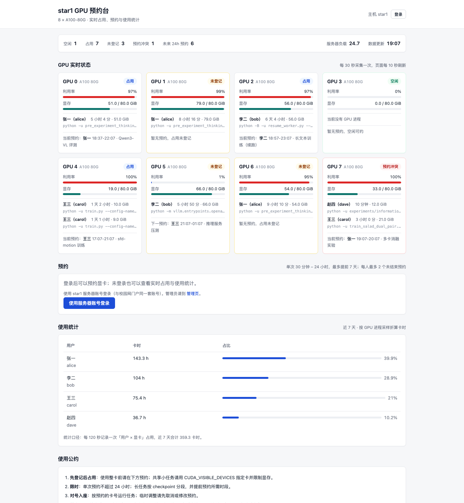
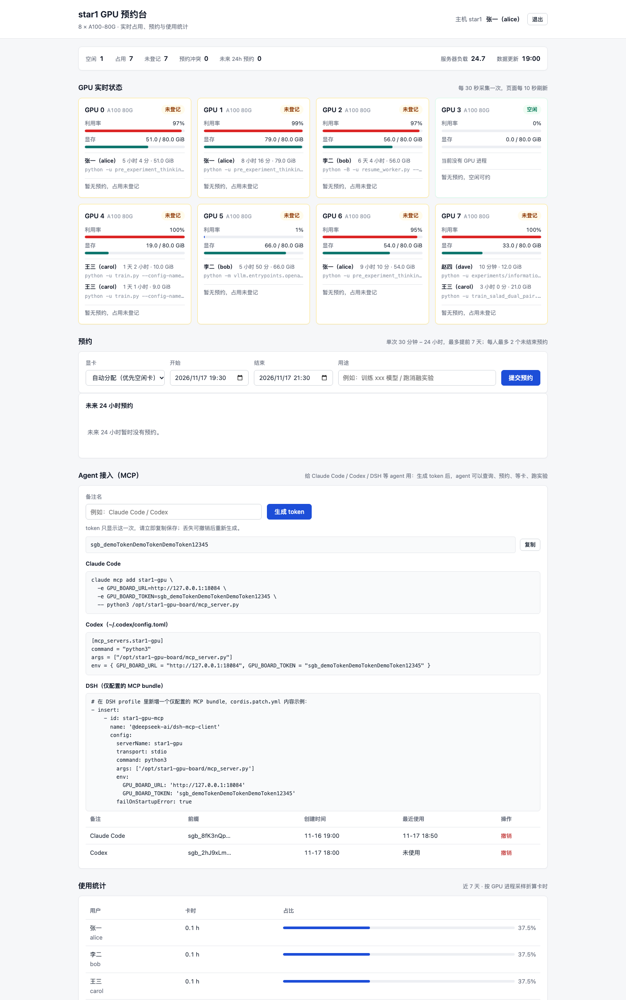

# star1 GPU 预约台

> 只读监控 + 预约登记，一个单文件 Python 服务（仅标准库）。
> **复用 campus-signup 的账号与运维体系**，不改动、不重启门户服务，对服务器上的
> CPU / 内存实验零影响。

## 0. 当前部署状态（2026-11-17 已上线）

| 项目 | 值 |
|---|---|
| 访问地址 | **https://10.0.0.10:8083/**（证书与门户相同，浏览器提示自签名属正常） |
| 管理员入口 | https://10.0.0.10:8083/admin （口令 = 校园网门户管理员 token） |
| 服务 | `star1-gpu-board.service`（systemd，开机自启；运行账号 `signupapp`） |
| 数据 | `/var/lib/star1-gpu-board/board.db`（SQLite，预约 / 会话 / 卡时采样） |
| Agent 接入 | MCP 服务 `/opt/star1-gpu-board/mcp_server.py`（stdio；token 在网页「Agent 接入」生成） |
| 资源 | 常驻约 24–30 MB 内存；CPU 上限 50%（最多半颗核），Nice=19、IO idle |
| 影响面 | 未改动 campus-signup / ceph / Prometheus / GPU 进程；未杀任何进程、未改卡片配置 |

### 界面预览



> 说明：卡片上的「未登记」表示该卡当前有 GPU 进程、但没有对应预约记录（上线初期所有卡都会这样，
> 用来提醒大家开始按公约预约）；「预约冲突」表示卡被预约给了 A，但实际运行的是 B。

---

## 1. 它解决什么问题

star1 有 8 张 A100-80G，多人共用时没有分配机制：有人一次占 2–3 张、任务连跑数天，
其他人不知道「谁在用、还要多久」，容易因抢卡产生矛盾。

本服务提供：

1. **实时看板**：每张卡的利用率、显存、温度、占用者（姓名 + 用户名）、已运行时长、命令摘要；
   自动标注「未登记占用」「预约冲突」。
2. **预约登记**：用服务器账号登录后按卡号 + 时间段预约，同一张卡同一时段只允许一个预约；
   支持「自动分配」（优先空闲卡）。
3. **使用统计**：按 2 分钟采样折算每人近 7 / 30 天卡时，作为公平分配的数据依据。
4. **管理员页**：复用 campus-signup 的管理员 token，可代学生预约 / 取消预约、查看统计与用户列表。
5. **Agent 接入（MCP）**：给 Claude Code / Codex / DSH 等 agent 提供 stdio MCP 服务，agent 可以查询、预约、等卡、在预约的卡上运行实验（详见第 9 节）。

设计边界：**不杀进程、不改 cgroup、不做任何强制**，只读 nvidia-smi / ps，只写自己的数据库。

---

## 2. 复用 campus-signup 的方式（重要）

| 能力 | 来源 |
|---|---|
| 用户登录 | star1 Linux 账号 + 密码，调用 campus-signup 的 root provisioner `verify_password` 校验；本服务不接触 `/etc/shadow`，密码不落库、不写日志 |
| 用户列表 / 中文姓名 | provisioner `list_users`（uid ≥ 1000、可管理账号；特权账号不出现） |
| 管理员 | campus-signup `security.admin_token`（每次登录时从 `/etc/campus-signup/config.json` 实时读取）+ `admin_allowed_cidrs` |
| HTTPS 证书 | campus-signup 的 `tls.cert` / `tls.key`（CN=10.0.0.10） |
| 界面风格 | 沿用校园网门户的浅色极简设计（同一组 CSS 变量） |

因此服务器**不需要新建账号体系**；运行服务的系统账号也直接用 `signupapp`（uid 994）：
它本来就能读 campus 配置 / TLS 证书，且是 provisioner 允许的对端 uid。

> 注意：`root`、`admin`、`signupapp`、`ops1`、`svc` 等保护账号在 provisioner 侧被标记为不可管理，
> 因此**不能作为普通用户登录**（与门户规则一致）；admin 请用管理员 token 进 `/admin`。

---

## 3. 访问

- 校内网直接访问：**https://10.0.0.10:8083/**
  （证书与门户 8444 相同，浏览器首次会提示自签名证书，与门户一致）
- 校外 / 无法直连时，用 SSH 端口转发（证书 SAN 含 127.0.0.1，可直接用）：

  ```bash
  ssh -L 8083:127.0.0.1:8083 你的用户名@10.0.0.10
  # 然后浏览器打开 https://127.0.0.1:8083/
  ```

- 管理员入口：`https://10.0.0.10:8083/admin`（口令 = campus-signup 管理员 token；
  仅校内网 / SSH 隧道可登录）。
- 登录说明：普通用户用 **star1 服务器账号 + 密码**登录（与 SSH 同一套密码，由 portal 的
  provisioner 校验；本服务不保存密码）。`root` / `admin` / `signupapp` / `ops1` / `svc` 等保护账号
  按门户规则不可作为普通用户登录，请用管理员 token。

---

## 4. 部署 / 升级 / 卸载

在 star1 上（把整个目录拷到 star1，例如 `/tmp/star1-gpu-board`）：

```bash
sudo bash deploy/install.sh      # 安装或升级（幂等；升级会重启本服务，不影响门户）
sudo bash deploy/uninstall.sh    # 卸载（交互确认；--yes 跳过询问）
```

安装脚本会：

- 检查 `signupapp` 账号、campus-signup 配置、TLS 证书、provisioner socket、nvidia-smi；
- 安装到 `/opt/star1-gpu-board`，数据目录 `/var/lib/star1-gpu-board`（属主 `signupapp`），
  配置 `/etc/star1-gpu-board/config.json`；
- 安装并启动 `star1-gpu-board.service`，做健康检查（`/healthz`）。

查看状态与日志：

```bash
systemctl status star1-gpu-board
journalctl -u star1-gpu-board -f
```

---

## 5. 配置（`/etc/star1-gpu-board/config.json`）

| 字段 | 默认 | 说明 |
|---|---|---|
| `bind` | `0.0.0.0` | 监听地址（写 `::` 可同时走 IPv6） |
| `port` | `8083` | 监听端口 |
| `tls` | `true` | 是否启用 HTTPS（复用门户证书） |
| `tls_cert` / `tls_key` | campus-signup 的证书路径 | 留空则自动用 `/etc/campus-signup/config.json` 里的 |
| `db` | `/var/lib/star1-gpu-board/board.db` | 会话 / 预约 / 采样数据库 |
| `sample_interval` | `30` | nvidia-smi 采集间隔（秒） |
| `history_interval` | `120` | 卡时统计采样间隔（秒） |
| `min_booking_minutes` | `30` | 单次预约最短时长 |
| `max_booking_hours` | `24` | 单次预约最长时长 |
| `max_booking_days_ahead` | `7` | 最多提前几天预约 |
| `max_future_bookings_per_user` | `2` | 每人最多保留几个未结束预约（防止一人占满） |
| `session_ttl` / `admin_session_ttl` | `43200` / `21600` | 会话有效期（秒） |
| `site_title` / `site_subtitle` / `contact` | 见示例 | 页面文字 |

修改后 `sudo systemctl restart star1-gpu-board`。

---

## 6. 资源占用与「零影响」承诺

- 单进程，仅标准库；常驻内存约 30–40 MB，CPU 基本为空闲（每 30 秒一次 nvidia-smi）。
- systemd 硬限制：`MemoryMax=128M`、`CPUQuota=50%`（最多半颗核，实际平均 <2%）、`Nice=19`、
  `IOSchedulingClass=idle`、`TasksMax=64`——即使异常也不会抢占 CPU / 内存实验。
- 只读：`nvidia-smi`、`ps`、`/proc/uptime`、campus 配置与 TLS 证书（只读挂载）；
  只写自己的 `/var/lib/star1-gpu-board`。
- 不改动任何现有服务：campus-signup / ceph / Prometheus / kubelet / 用户 tmux 全部不碰；
  不杀进程、不改 GPU 配置、不启用 MIG。
- 卸载即回滚：`deploy/uninstall.sh` 只删除本服务自己的文件。

---

## 7. 安全

- 登录密码只在内存中传给本机 root provisioner 校验；不写数据库、不写日志。
- 登录失败限流：同一 `(用户名, IP)` 15 分钟内失败 5 次即锁定；同一 IP 1 小时内失败 20 次锁定。
- 会话：服务端随机 token（`HttpOnly; Secure; SameSite=Lax`），用户 12 小时、管理员 6 小时过期。
- 所有 POST 要求 JSON + `X-Requested-With: star1-gpu-board`，并带 CSP、`X-Frame-Options: DENY` 等响应头。
- 管理员口令与门户同源，且受 `admin_allowed_cidrs`（默认 `10.0.0.0/8`、`127.0.0.1/32`）限制。
- 预约用途等用户输入在页面上均以文本方式渲染（无 innerHTML 注入）。
- 数据库备份：`sudo cp /var/lib/star1-gpu-board/board.db* /备份目录/`（SQLite WAL 模式，建议停服务后拷贝）。

---

## 8. Agent 接入（MCP）

看板自带一个 stdio MCP 服务，装在 star1 的 `/opt/star1-gpu-board/mcp_server.py`，
同学注册到自己用的 agent 里即可。共 8 个工具：

| 工具 | 作用 |
|---|---|
| `gpu_status` | 8 张卡实时状态：利用率、显存、进程（谁/跑了多久/在跑什么）、预约、空卡汇总 |
| `gpu_bookings` | 查预约（`scope=mine` 或 `all`，未来 N 小时） |
| `gpu_book` | 预约（`gpu` 卡号或 `auto`；`start` 支持 `now+30m` / ISO8601；`duration_minutes` 默认 120；`purpose` 必填） |
| `gpu_cancel` | 取消自己的预约 |
| `gpu_wait` | 阻塞等到预约生效（默认最多 5 分钟） |
| `gpu_run` | 在「当前生效预约」的卡上执行命令（自动设置 `CUDA_VISIBLE_DEVICES`；长任务用 `background: true` 返回 pid+日志路径） |
| `gpu_usage` | 近 N 天每人卡时统计 |
| `gpu_rules` | 返回使用公约摘要 |

### 8.1 生成 token

网页登录（右上角）→ 页面下方「Agent 接入（MCP）」→ 填备注名 → 生成 token（只显示一次）。



> 界面预览（mock 数据）：生成后直接给出 Claude Code / Codex / DSH 三种配置，可复制。

token 也可以用文件方式保存，避免写入 agent 配置：

```bash
mkdir -p ~/.config/star1-gpu && chmod 700 ~/.config/star1-gpu
read -r -p "粘贴 token: " T && printf '%s' "$T" > ~/.config/star1-gpu/token && chmod 600 ~/.config/star1-gpu/token && unset T
```

### 8.2 注册到 agent

**Claude Code**（在 star1 上执行）：

```bash
claude mcp add star1-gpu \
  -e GPU_BOARD_URL=https://10.0.0.10:8083 \
  -e GPU_BOARD_TOKEN=sgb_你的token \
  -- python3 /opt/star1-gpu-board/mcp_server.py
```

**Codex**（`~/.codex/config.toml`）：

```toml
[mcp_servers.star1-gpu]
command = "python3"
args = ["/opt/star1-gpu-board/mcp_server.py"]
env = { GPU_BOARD_URL = "https://10.0.0.10:8083", GPU_BOARD_TOKEN = "sgb_你的token" }
```

**DSH**：在 profile 里加一个仅配置的 MCP bundle（`cordis.patch.yml`）：

```yaml
- insert:
    - id: star1-gpu-mcp
      name: '@deepseek-ai/dsh-mcp-client'
      config:
        serverName: star1-gpu
        transport: stdio
        command: python3
        args: ['/opt/star1-gpu-board/mcp_server.py']
        env:
          GPU_BOARD_URL: 'https://10.0.0.10:8083'
          GPU_BOARD_TOKEN: 'sgb_你的token'
        failOnStartupError: true
```

> 不写环境变量时，MCP 服务会自动读取 `~/.config/star1-gpu/token` 和默认地址
> `https://127.0.0.1:8083`，所以注册时也可以只保留 `command`/`args`。

### 8.3 使用效果

注册后，agent 可以自己完成：查卡 → 预约 → 等卡 → 跑实验 → 看统计。例如对 agent 说：

> "帮我看看 star1 现在哪张卡空着，预约一张跑 2 小时的消融实验，跑完把结果和 GPU 用时报给我。"

agent 会依次调用 `gpu_status` → `gpu_book` → `gpu_wait` → `gpu_run`（自动 `CUDA_VISIBLE_DEVICES=预约卡号`）→ `gpu_usage`。

> `gpu_run` 只在 MCP 服务运行于 star1 上时可用（默认通过 hostname 判断，可用 `GPU_BOARD_RUN=1/0` 覆盖）；
> 在笔记本上跑 agent 时仍可查询和预约，但不能远程跑实验。
> 长任务建议 `background: true`，返回 pid 和日志路径（`~/.local/state/star1-gpu/runs/`）。

### 8.4 安全

- token 只代表你自己的账号：只能预约/取消自己的预约，不能进 `/admin`；
- 每个 token 显示一次、可在网页随时撤销，最近使用时间可在面板看到；
- 不要把 token 提交进 git / 群聊；建议放 `~/.config/star1-gpu/token`（chmod 600）；
- 管理员的门户 token 不用于 MCP。

---

## 9. 本地开发 / 自测

```bash
cd star1-gpu-board
python3 server.py --mock --no-tls --port 18083 --static ./static --db /tmp/board-mock.db
# 浏览器打开 http://127.0.0.1:18083/
# mock 用户：alice / bob / carol / dave / erin，密码 Passw0rd!23
# mock 管理员口令：mock-admin-token
python3 tests/smoke.py --port 18083      # HTTP 接口冒烟测试（需先启动 mock 服务）
python3 tests/test_mcp.py                # MCP 服务端到端测试（自动拉起 mock 看板）
```

---

## 10. 后续可加（按需）

- **飞书 / 企业微信群机器人提醒**：预约超时、占卡未登记自动 @ 人（需要群 webhook URL）。
- **MCP 工具扩展**：如 `gpu_tail`（查看后台任务日志）、`gpu_jobs`（列出自己在跑的进程）。
- **Slurm 迁移**：本看板可作为过渡期工具；等大家接受「先登记」后，再上单机 Slurm
  （`sbatch` / `srun` 排队、限时、每人限卡），本服务的预约数据可导出为规则依据。
- **多机扩展**：若 star2 等机器加入，可把采集器扩展为多节点 + 统一入口（当前只做 star1）。

---

## 11. 上线通知模板（可直接发群）

> 【star1 GPU 预约台已上线】https://10.0.0.10:8083/
>
> 以后用卡请先看一眼看板、顺手登记：
> 1. 登录：用你的 star1 服务器账号密码（和 SSH 同一套），点右上角「登录」；
> 2. 预约：选卡（或自动分配）+ 开始/结束时间 + 用途，同一张卡同一时段只允许一个预约；
> 3. 限时：单次不超过 24 小时，每人最多保留 2 个未结束预约；长任务请按 checkpoint 分段并续约；
> 4. 看板是只读的：不会杀进程、不影响任何人的 CPU/内存任务，只帮大家把「谁在用、用到什么时候」讲清楚；
> 5. 管理员：管理员甲 / 管理员乙（用门户管理员 token 进 /admin 可代约、取消、看统计）。
> 6. 用 agent（Claude Code / Codex / DSH）的同学：登录网页后到「Agent 接入（MCP）」生成 token，
>    按页面给的配置注册 MCP 服务，你的 agent 就能自己查卡、预约、等卡、跑实验（详见 README 第 8 节）。
>
> 初期所有卡会显示「未登记」，属正常现象——意思是有人在用但还没预约，之后会按公约逐步规范。

